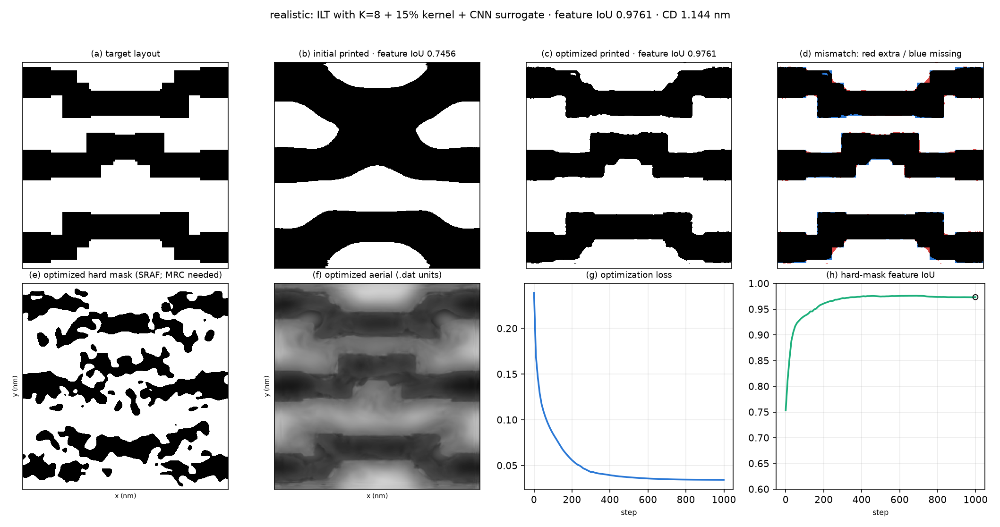

# ILT case: realistic

This is a kept demonstration case, not a production ILT recipe.

- Target: `realistic` from `ilt.layouts` (800 × 800, 1 nm/px, periodic;
  three Manhattan nets with pads, bends and landing regions).
- Imaging model: final `kernel15_cnn_k8.pt` surrogate (K=8 SOCS + 15% kernel + CNN).
- Threshold: `0.346585`; target/printed semantics: 1 = feature.
- Optimizer: `PixelILT`, 1000 iterations requested,
  hardening 30%, Adam lr 0.08.
- 1 nm/px mask filter: sigma 10.0 px,
  border margin 0 px, boundary radius
  8 px, TV weight 0.01.

## Results

| metric | initial (target as mask) | optimized | change |
|---|---:|---:|---:|
| feature IoU | 0.7456 | **0.9761** | +0.2305 |
| clear IoU | 0.7221 | **0.9804** | +0.2582 |
| contour CD | 16.853 nm | **1.144 nm** | -15.709 nm |

- Completed 1000 steps; best hard-mask step 690.
- Stop reason: `maximum iterations reached`.
- Timing: model load 0.69 s, optimization **28.39 s**
  (28.4 ms/step,
  35.2 steps/s),
  total 31.07 s on cuda:0.
- Mask complexity: 30 connected components,
  0 tiny fragments (≤4 px), TV 0.0245,
  feature fraction 0.3511. The mask contains sub-resolution
  assist features (SRAF); run mask-rule-check/OPC cleanup before manufacturing.
- Target is shown black on white; optimized mask/printed images use the same
  convention. `mismatch.png` colors: red = extra feature, blue = missing feature.



## Files

```text
target.png                 # target layout (black = feature)
initial_printed.png        # printed image with target as mask
optimized_printed.png      # optimized hard-resist printed image
optimized_mask.png         # optimized hard mask
optimized_aerial.png       # optimized aerial image (.dat units)
mismatch.png               # optimized vs target binary mismatch
comparison.png             # 8-panel summary
history.csv                # per-validation-step loss/IoU history
metrics.json               # full metrics + timings + config
```

## Note

The case generator script is not included in this release; the files above are
a static snapshot produced by `PixelILT` + `kernel15_cnn_k8.pt`.
